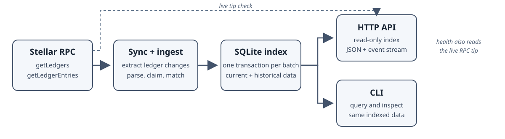
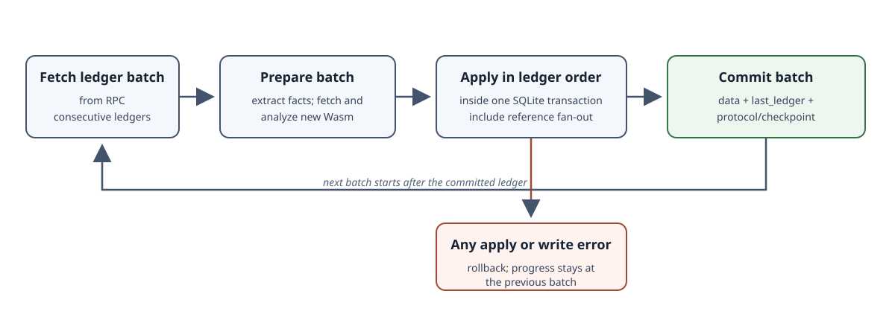
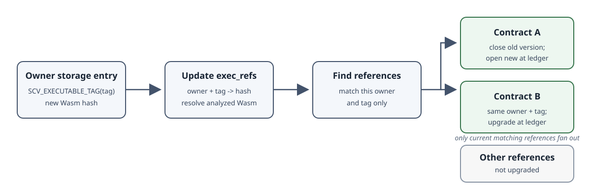

# Architecture

These diagrams follow the implementation: ledger batches enter through RPC,
ingest prepares and applies changes, and the API and CLI read the same SQLite
index.

## Data flow

The API uses the RPC client only for the live tip in `/v1/health`; indexed
contract data comes from its read-only SQLite connection.

## Sync batch

Batch commit behavior is implemented in
[`internal/sync/loop.go`](https://github.com/Soroban-CII/soroindex/blob/main/internal/sync/loop.go).
Changes are applied in
ledger order before `last_ledger` and the ledger checkpoint are written in that
same transaction.

## CAP-85 reference fan-out

Reference updates are applied in
[`internal/ingest/apply.go`](https://github.com/Soroban-CII/soroindex/blob/main/internal/ingest/apply.go):
the index stores the new owner/tag mapping, resolves the Wasm and updates
contracts currently referencing that pair. Contracts with other references are
not part of that fan-out.
